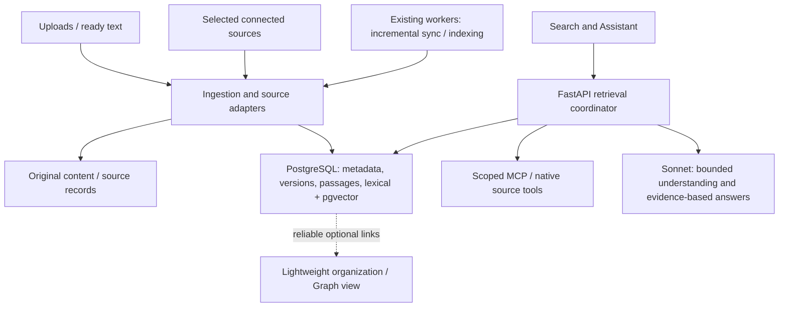

# Linkmind - Current Architecture and Retrieval-First Target

2026-11-17 latest delivery: Schema 0020 adds auto policy, archived_at and attachment_document_ids. New auto_agent performs up to three bounded model-directed observation/search rounds before synthesis and independent semantic verification. Attachments are current permission-checked references; full connected bodies remain transient. Existing owner-bound source access is unchanged. See [automatic chat results](AUTO_CHAT_RESULTS.md). Earlier dated requirements below are historical where superseded.

2026-11-17 target clarification: upstream connections belong to the organization; admin credential management and employee read authorization are separate. Backend service identities obtain fresh provider tokens independently of employee sessions. Central grant resolution must gate discovery, reads, retained records, graph/evidence, history and caches. Current owner-bound checks are prototype limits, not organization sharing. See [organization connection design](ORG_MANAGED_CONNECTIONS.md).

2026-11-17 source boundary: schema 0019 adds chat policy and exact-byte fixture provenance. Connector retention mode and chat corpus policy are independent. Live Only forbids stored retrieval and fallback; stored and combined remain deliberate choices. Scope is checked before retrieval, before saving/delivery, and on history/context reuse. Demo loaders/integration suites require an isolated mock handshake. See [current repair](SOURCE_POLICY_REPAIR.md).

2026-11-16 main-chat architecture: the ordinary conversation path now coordinates
stored retrieval and bounded owner-enabled Jira/Confluence search/read automatically
when LINKMIND_CHAT_AGENT=1 (enabled in isolated 5197). Field pointers resolve original
typed values on the server; exact anchoring and independent whole-statement review can
drop individual unsupported points while retaining supported ones. Schema remains
0018, policy v11. Existing conversation JSON stores derived text/cited excerpts or field
values and live dependency metadata; full live evidence context is redacted, with no
automatic native document/raw-provider import. History/follow-ups and source panels
recheck source access, generation and revision. Scoped-document and explicit historical
routes retain their boundaries. See [current delivery](MAIN_CHAT_RESULTS.md) for bounds,
retention, actual acceptance and Arabic/production limitations. Earlier descriptions of
stored-only main chat and transient-only answering are dated checkpoints.

Latest RF5 local architecture, 2026-11-15: `/source-answers` combines explicit selected
documents/retained history with at most two selected live resources. It reuses existing
adapters, query limits, source authorization and model/spend guards. A new typed citation
contract distinguishes literal passages from exact JSON field/value support; independent
semantic verification remains required for real synthesis. Results are transient with
no new persistence tables, services, graph writes or automatic corpus selection. Access,
connection generation and live revision are checked before model exposure/delivery and
before evidence opening. Owner-bound runtime source choices do not expose admin config.
Schema stays 0018. See [RF5 results](RF5_RESULTS.md); actual source/model acceptance remains open.

Latest architecture checkpoint, 2026-11-15: current source/new isolated 5195 preview
requires **0018_connection_oauth** and `grounded-v10-qualified-statement-support`.
The full-statement answer audit checks temporal, authority and operational freshness
support. Known RF3 failures have bounded Sonnet repair evidence. RF4 now has encrypted
server-owned delegated OAuth/refresh state, owner/generation/cookie-bound single-use
callbacks, reserved credential bindings, native API gateway routing, bounded scope
metadata discovery and explicit selection. Existing worker/access/evidence contracts
are reused. **315 API / 39 browser / build** and final 8 OAuth checks passed.
No real provider is configured or contacted; real-source and production delegated
permission acceptance remain deferred. See [current results](RF34_RESULTS.md) and
[runbook](RF4_OAUTH_RUNBOOK.md). Older checkpoints below are dated states, not current
instructions to deploy onto protected schemas.

2026-11-15 RF4 delivery: source connections, checkpointed selected collection, retained
external provenance and admin lifecycle are implemented in the isolated 5194 stack,
with migrations 0016/0017 and `grounded-v9-connected-source-access`. Native adapters and
bounded MCP interfaces exist, with five labelled demo connector types. Configuration,
mock authentication, testing, modes, editing/removal and ordinary-worker collection are
functional; **292 API / 37 browser / build** passed. Default external networking is off.
Real OAuth/consent and provider/account acceptance remain pending. See [RF4 results](RF4_RESULTS.md)
for the owner-bound local access model and actual limits. Prior RF1/RF2/RF3 preview
builds/schemas stay untouched; RF3's two real-model grounding gaps remain open.

2026-11-15 checkpoint: current source includes RF3 migration 0015, bilingual lexical
retrieval, bounded context/coordinator/query limits, retained revision comparison and
actual retrieval activity. The trust policy is `grounded-v8-bounded-source-context`.
Mock RF3 5192 and separate Bedrock RF3 5193 passed 264 API / 34 browser / build checks;
the eight-prompt real trial exposed two grounding/verifier sensitivity gaps, so model
quality acceptance remains open. See [RF3 results](RF3_RESULTS.md). RF1 5189 stays at
schema 0013, RF2 5191 stays at 0014, and protected builds/data remain unchanged.
Live connector orchestration is still an offline adapter contract; RF4 is planning only.
The dated RF1/RF2 architecture description below is superseded on those RF3 details.

Updated **2026-11-14** after the restructure and subsequent RF1/RF2 approvals.
Current source includes RF2 in a new isolated mock stack at 5191: **231 API tests,
32 browser workflows and frontend build passed**; final RF2 follow-up passed too.
Existing main/previews are unchanged. Remaining target sections are planned unless
identified as RF1/RF2 below. See [RF1 delivery](RF1_RESULTS.md) and [RF2 results](RF2_RESULTS.md).
Use [scope](PROJECT_SCOPE.md) for requirements and [the roadmap](IMPLEMENTATION_PLAN.md)
for implementation order. The filename remains stable for existing links.

## 1. Current implementation - facts to preserve

### Storage and processing

Original uploaded bytes are retained by organization and checksum. Documents select an
immutable current content revision; stable passages retain page/line/paragraph/table
locators. PostgreSQL leases background jobs with bounded attempts, expiry and publication
guards. Parsing failures do not silently replace the last valid active content.

RF1 `prepare_content()` parses/stores stable passages and publishes `search_ready_at`
and the current revision before semantic indexing. `index_passages()` then attempts
embeddings, reusing compatible exact-text vectors only inside the same tenant/document.
It records ready/unavailable/failed status separately; interrupted pending indexing
resumes from stored passages/vectors without parsing again. Lexical search remains usable.

`processing_jobs.enrichment_requested` defaults false for new jobs. Ordinary upload,
revision and internal `add_version()` calls therefore finish without `enrich()`, identity
resolution or conflict assessment. Status `ready` means job completion, not inferred
knowledge enrichment; the API reports `enrichment_status=not_requested` until optional work
is requested. `processed_at` retains its original successful-enrichment meaning.

An authorized explicit reprocess action atomically creates a staged candidate and sets
`enrichment_requested=true`. Labelled graph/Northstar dataset loaders explicitly request
fixture enrichment. Ordinary uploads of identical fixture bytes still default off, while
idempotent reuploads preserve an existing job's intent/history. Migration 0013 retains
all pre-existing job intents as true and sets the new-row default false; it does not
reprocess, cancel or relabel old jobs. Existing queued work needs review at later rollout.

Optional enrichment retains Sonnet batches, exact/schema/reference validation, semantic
verification/correction, identity resolution, conflict assessment and guarded atomic
publication. It is not required for source-only search or answers.

F1.3 supports same-source staged enrichment generations, verified activation and
rollback. Shared live views expose only the active, current-source generation. New
content revisions exclude superseded old-source facts. Retained passages/citations,
review records and generation history survive failed refresh. These safeguards are
valuable for existing data; they do not make enrichment mandatory in the target.

Latest local provider diagnostics include bounded extraction splitting, typed citation/
identifier failures and actual stop-reason recording. Latest recorded Lantern real-model
acceptance still failed verifier alignment; all four sources remained Search Ready.
No graph/answer quality claim follows from source-readiness or synthetic test counts.

### Retrieval and answers

RF2 adds source instances and explicit project/team groups around the existing document
store. Uploaded resource identity is tenant/source-instance/native-document ID; resource
type is document. The shared adapter identity also carries resource type explicitly.
One project/team per document can be assigned deliberately. A title/group update requires
source management permission and an expected metadata revision; it records the actor,
rejects stale edits and performs no extraction/indexing. Names alone never merge groups.
The paginated resource catalog searches titles, content and explicit groups independently
of the processing-job cap or extracted entities. Shared source/format/group/date predicates
apply to all retrieval rankings and the final authorization check. Existing entity-kind
filters are still optional filters for enriched data, not a source-only requirement.

`retrieval.py` combines bounded lexical, exact/identifier, graph-assisted and compatible
vector candidate rankings. Source/organization/current-version checks apply before
ranking and again before passage delivery. Some entity-kind filters still depend on
extracted entities: those must not become required source-type/project filters in the target.

`conversation_routing.py` and `conversational.py` understand help, source discovery,
selected-source overviews and factual follow-ups. They do not yet select live connectors.
Overview context is sampled/bounded and reports coverage. Factual answers use original
source passages with exact citations and a separate semantic check. No unsupported
answer is saved as trusted by the runtime. Current source uses
`grounded-v8-bounded-source-context`, retaining v7 whitespace anchors; older
reports/previews use earlier policies and must not be described as identical builds.
The answer path can map one unique whitespace-only match inside the cited passage
back to an exact original substring, then reapply strict citation and semantic checks.
Cross-passage, ambiguous or content-changing repairs are rejected. Correction feedback
supplies the exact authorized failed passage; extraction validation is unchanged.

Saved conversations recheck source/version, access, grounding-policy and relevant
enrichment dependencies. RF1 records a generation dependency only when retrieved entity
metadata exists; selected-source overviews use text alone and carry no new generation
dependency. New source-only answers therefore survive optional enrichment activation,
while source revision/access invalidation still applies. Stored legacy dependencies and
trust policy are not rewritten. Metadata-only suggestions also require reauthorization.
Conversation memory assists reference resolution; it is not source truth. Graph navigation
is not completed multi-hop answer reasoning. Generated entity pages are not native authoring.

### Operations and deployment boundary

The application is local React/TypeScript/React Flow + FastAPI/Python + PostgreSQL/pgvector,
with local artifact storage and existing database-backed workers. Bedrock uses boto3.
Usage persists independently of publication, including failed calls. Shared request
pacing and the optional persistent test-spend guard are retained; they are not an AWS
billing account hard cap. Historical local quota observations are not fresh capacity proof.

Production sign-in, external source instances/connectors/sync, managed Spaces, native
editing and adaptive live routing are not implemented. Main and previews have different
schemas/builds. Last recorded main schema was 0010; current migrations include 0011–0015.
RF1 initially used a new mock stack at port 5189. After confirmed login, its API/worker
now use Sonnet with separate RF1 content and the original shared spend/pacing database.
Main and older service containers remain unchanged; normal shared budget/pacing writes
are the explicit exception to the original ledger protection. See [AI preview](RF1_AI_PREVIEW.md).
RF2 runs separately at 5191 with schema 0014, no AWS mounts/provider and no paid usage.
RF1 Sonnet remains on its earlier schema 0013/build. All 48 previous container IDs and
RF1 source/budget fingerprints were unchanged at RF2 postflight.

## 2. Target deployment - reuse the stack

These are logical modules and responsibilities, not new microservices. Keep one API,
the current worker pattern, PostgreSQL and original-file storage. Add deployment
boundaries only when there is measured need. External OCR/conversion services are
upstream concerns if later requested; they are not part of this architecture increment.

## 3. Repository contract

The company repository durably retains selected uploaded/synchronized knowledge. It
is not only a vector index or transient tool cache. Source records remain attributable;
search indexes and graph views are replaceable projections, not canonical source content.

Minimum conceptual records, evolving existing models only when a capability needs them:

| Concept | Meaning / invariant |
| --- | --- |
| Resource | Stable identity: organization + source instance + type + native ID; uploads keep their existing document identity |
| Source/content revision | Original content or structured source payload, checksum/version marker and lineage; immutable evidence identity |
| Passage / field evidence | Source-local text locator or actual typed API field/value, tied to a revision or retained observation |
| Metadata | Title, source type/link, timestamps, language if useful, reliable project/team references; optional values stay unknown |
| Index projection | Lexical text and compatible embeddings; model/dimension/policy identifiers and index status |
| Connector scope/checkpoint | Mode, selected source scope, health, cursor and last successful collection, only when sync is built |
| Optional association | Explicit source link, stable identifier or deliberate human link, with provenance and source dependencies |

Source instance identity must survive replaceable credentials/reconnection. Similar
names, an author name, or model confidence alone cannot merge resources or establish
project ownership. Do not create tables for future-only training, approval or conflict
workflows. Existing claims/entities/relationships remain retained and usable under
current-source/access rules; no destructive schema replacement is planned.

## 4. Target ingestion - no routine Sonnet extraction

1. Authorize and validate input, retain original content/source payload and identity.
2. Parse extractable text or map structured fields using ordinary code. Preserve source
   structure/locators; bound file size and processing. No OCR or model interpretation is
   required for the core text contract.
3. Carry source-provided metadata and reliable references; optional metadata assistance
   must have a concrete use case. No default LLM summary, taxonomy or ontology pass.
4. Build lexical search and bounded passage/index representations. Prepare semantic
   embeddings with the existing separate embedding provider; measure its calls/cost.
5. Publish valid authorized current text independently. Report embedding degradation
   honestly; lexical readiness need not wait for semantic availability.
6. Finish ordinary ingestion. **Entity/claim/relationship extraction, model-based identity
   resolution and cross-document conflict assessment are default off.** Explicit optional
   enrichment can later use the existing verified staging mechanism and its own scope.

Proposed product states are understandable availability/index states. Internally,
not-requested enrichment must be distinguishable from unavailable/failed enrichment.
RF1 implements this using one job-intent boolean and derived API state, not a new
processing service or knowledge store. Migration 0013 refuses downgrade after source-only
jobs exist; use the reviewed snapshot/prior build for restoration.
Existing fixture graph demos may remain explicit fixtures; they must not silently
opt ordinary production documents into enrichment or pretend arbitrary mock extraction.

Only changed content needs new indexing. Compare source version/checksum first. Reuse
unchanged embeddings only with a compatible model/dimension/index policy and valid
source/tenant mapping. Preserve original citation passages even if a later index uses
better heading-aware chunks/parent context. No full-corpus graph rebuild on each sync.
Access/metadata-only changes still reconcile immediately without semantic interpretation.
Unchanged-content deduplication must never bypass revocation, source identity or history.

RF1 implements lexical availability before embeddings using the existing current-source
publication guard. Each vector update/final index status rechecks revision, current source
and lease. Losing the lease before publication cannot activate content; losing it during
indexing cannot finish the job or promote facts, while valid already published text stays
searchable. Pending indexing resumes without replacing citation passages.

## 5. Source catalog and bounded query coordination

**RF2 implemented:** a permission-filtered catalog of retained uploaded sources reports
actual indexed/history operations, visible counts, local health and received/indexed
times. Live is false and sync time remains unknown. It contains no credentials or
inactive connectors. The bounded multi-source coordinator below remains RF3/RF4 work.

A lightweight catalog describes only configured source instances/scopes: supported
resource types, projects/folders/channels, searchable metadata, available operations,
live/index/history capabilities, freshness/health and applicable access constraints.
It is not a second knowledge graph, a list of all company facts, or source instructions.
The model cannot invent an adapter/tool that the server does not expose.

Query flow:

1. Resolve explicit IDs, selected files/project scope, question meaning/time and recent
   authorized references. Clear requests can route directly without a planner call.
2. Pick likely sources from their capabilities/catalog and known resource links. Use a
   bounded Sonnet plan only when useful; do not enumerate every source for every question.
3. Retrieve bounded candidates. Stable document questions prefer indexed text/fields;
   current operational questions prefer the relevant live source; historical questions
   require history/dated evidence. Compound questions may combine both.
4. Deduplicate and rank evidence for direct support, relevance, source meaning and time.
   Add adjacent/parent context when it materially helps, under the same source/access
   boundary. An optional graph link may locate evidence, but no graph join is mandatory.
5. Check whether evidence covers each requested part. If incomplete, expand the query
   or another relevant source within remaining scope/budget. Clarify consequential
   identity/scope ambiguity; do not assume the first routing choice is correct.
6. Produce a cited answer or clear partial/insufficient result. Preserve material
   disagreements, actual values and distinctions such as Jira assignee versus owner.

Independent tool calls can run concurrently under bounded concurrency. Dependent calls
remain sequential. Enforce total tool calls, planner/retrieval rounds, evidence/input
size, model output/calls, timeout and spend limits in code, not merely in prompts.
Exact numeric limits are to be agreed/measured in RF3. Outage, denial, empty retrieval,
provider rejection and budget exhaustion must not collapse into a false success state.

Ordinary answers read relevant retrieved evidence. Broad summaries need a separate
coverage-aware bounded path; sampling must not be described as a full document review.
On-demand cross-source inference is answer-scoped and attributable. It does not silently
become a shared relationship or replace original records with generated prose.

## 6. Common evidence for local and live sources

**RF2 implemented:** `SourceEvidence` / `ResourceIdentity` and the additive provenance
envelope on existing local evidence responses. Retained passage IDs/locators/downloads
are unchanged. Uploaded observed time is received time; source-updated/original remote
URL stay unknown. Coverage explicitly identifies one passage rather than a full review.
Transient live excerpt/structured-field contracts are validated using offline fixtures
only, with same-tenant access dependencies and timezone-aware observation times. No
actual live invocation or automatic shared persistence exists yet.

A common evidence envelope is a conceptual adapter contract, not a demand to remodel
all existing passage IDs. It carries:

- Source instance/resource identity, original URL and resource type.
- Exact supporting excerpt plus locator, or actual structured field/value semantics.
- Source revision/update marker when available, observed time and historical scope.
- Access dependencies, completeness/pagination limits and retrieval coverage.
- Stable citation reference for the retained observation/revision under retention policy.

Do not invent verbatim quotations for structured JSON fields. Retain enough evidence to
inspect what supported an answer even when the source later changes; retaining it does
not grant ongoing access. Local passages preserve existing IDs and locators. An immutable
observation can be saved when an API lacks revisions, without claiming it is source history.

Before model exposure and delivery, recheck the applicable source/tenant boundary.
History/caches reauthorize all evidence dependencies, not merely visible citations.
Optional enrichment generations are dependencies only when the answer actually used
them; removing graph dependency must not suppress raw-source-only answers unnecessarily.
Review this dependency change compatibly in implementation, not by rewriting old turns.

Current exact-source/reference validation and fail-safe answer behavior remain until
an evaluated replacement is accepted. Proportionate additional semantic verification
is an experiment, not automatic removal of the second call. Validate support, same-name
identity, numbers/dates, disagreements and injection handling on held-out questions;
bump the answer validation policy if trust rules change. A verifier boolean or an exact
quote alone is not evidence of complete factual entailment.

## 7. Live access and persistent synchronization

MCP/native adapters expose actual capabilities for search/fetch/current fields/history
and, where supported, collection/checkpoints/permission checks. Live access and bulk
sync may use different transports. An available MCP integration is not by itself a
complete source connector or application authentication arrangement.

| Mode | Immediate answer | Persistent shared repository |
| --- | --- | --- |
| Live Only | Use authorized scoped observations | No automatic index/graph enrichment; temporary answer/citation retention only |
| Live + Sync | Use live tools when freshness requires | Collect selected scopes, retain source revisions and update indexes incrementally |
| Not Connected | Do not call the source | Exclude disallowed active/cache exposure; retained history is still policy-bound |

Sync uses existing durable worker patterns with cursor/checkpoint, pagination, bounded
retry/backoff, idempotent version identity, and safe failure recovery. Collect changed
records, not every source on every question. Reconcile deletions and access changes,
including rarely queried resources. Missing from a search page does not prove deletion.
A partial/user-filtered live result must not replace a complete sync record or erase
fields. Refetch under proper sync scope if version, completeness or access is uncertain.
Older observations cannot overwrite newer state; source-updated/observed/effective time
are distinct. Do not introduce an event platform or model call per source modification.

A live observation may request a deduplicated background refresh inside an approved
sync scope without delaying the answer. Mode/scope removal stops ongoing collection and
excludes disallowed material from active retrieval; handle retained history explicitly.
Source outage permits clearly dated last-known fallback only with reliably established
access. Unknown/revoked authorization never permits fallback. Display health and last
successful sync rather than claiming every stored record is live-current.

Each source passes its own lifecycle gates. First connector/order/scopes are a pre-build
decision; Jira is the previous candidate, document-source collection is a core capability,
and no mandatory Confluence/GitLab/graph sequence blocks a OneDrive/SharePoint proof.

## 8. Lightweight organization and optional graph

RF2 delivers explicit, permission-checked project/team associations, source-qualified
identity and grouping filters without adding graph records. These labels are repository
organization, not verified source claims or automatic identity joins. Rich group/Space
administration and inferred associations remain deferred.

Use source-qualified project IDs, folder mappings, explicit repository/issue/document
links and deliberate human associations. Resource-to-project grouping does not need
managed Spaces or native authoring. Source metadata is often sufficient without an LLM.

The existing graph remains an optional authorized view of supported links. Missing
graph facts do not imply missing stored knowledge. Existing generation/current-source
rules continue to prevent stale relationships. Unsupported new links never appear as
facts. Persisted inference, if later requested, stays distinct from explicit association
and needs evidence, scope and invalidation. Advanced graph paths are deferred until
measured benefit over hybrid retrieval justifies them.

## 9. Security, runtime cost and release boundaries

Preserve current organization isolation, owner/org visibility, access checks on all
metadata/content/derived surfaces, source restrictions, secret handling and prompt/data
separation. Detailed groups/delegation/Space ACL design is later; adequate source access
checks are necessary for each connector. Production authentication is still a prerequisite
for real employee access. Local demos are not production auth. Links never expand access.

Keep independently persisted model/embedding/tool usage, errors, latency and retries.
Record unknown usage as unknown; avoid unsupported savings percentages. Prioritize
interactive work relative to background indexing using existing scheduler patterns only
as measured need justifies. More workers do not bypass model/source quotas.

Initial RF1 acceptance used mock/stubs. The later confirmed AI preview uses the original
`northstar-sonnet-2026-11-12` USD 10 cumulative ceiling; no cloning/reset/unpause.
Its bounded real trial and 215 deterministic checks are recorded in [AI results](RF1_AI_PREVIEW.md).
Any additional agent-run evaluation requires an explicit bounded scope/budget; old extraction
repair proposals do not mandate another paid acceptance run for the retrieval core.

Before rollout: inspect actual main/preview build and schema, compatible migrations,
source/citation/history fingerprints, backup originals plus DB, restore into an isolated
rehearsal, and prepare rollback including post-snapshot writes. The older
[main-data procedure](MAIN_DATA_ROLLOUT.md) is a safety reference, not the current cutover
candidate: its staged-enrichment-only gate must be reviewed for RF delivery and the
current migration chain through 0015.
The known main API/worker accounting mismatch must not become unguarded paid inference.
No source-only change is authorized to delete existing evidence/generations or bypass
schema guards. Deployment still needs its own security/cost review and approval.

## 10. Acceptance evidence and historical compatibility

Test source-only ingestion with extraction/conflict functions forbidden, ordinary queries
with empty graph tables, revisions and revoked access, lexical fallback, unchanged sync,
source-tool failures, bounded expansion and common citations. Separately measure held-out
Arabic/English retrieval and answer support, operational freshness, p50/p95 latency,
source/model calls and per-workload cost. Agree numeric targets before live acceptance.
Preserve existing optional-enrichment/graph regression coverage rather than loosening it.

F1.1/F1.2/F1.3, persona, discovery and Lantern reports remain dated evidence. Their old
implementation instructions do not schedule new work. Full prior architecture detail is
preserved in the [archived snapshot](reference/pre_restructure_2026_11_14/ARCHITECTURE_M2_M3.md).
See the single roadmap for current sequencing and explicitly deferred capabilities.
