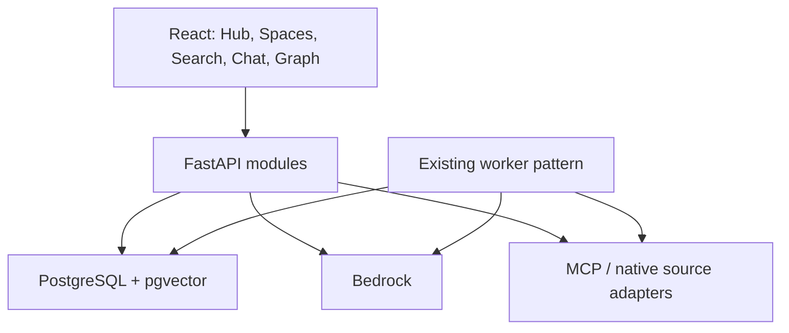

> **Archived planning snapshot, superseded 2026-11-14.**
> This preserves earlier requirements, checkpoints and proposed work. Its delivery
> order, next tasks, commands and authorizations are not active instructions.
> Use the [active roadmap](../../IMPLEMENTATION_PLAN.md),
> [scope](../../PROJECT_SCOPE.md) and [architecture](../../ARCHITECTURE_M2_M3.md).
> Relative Markdown links were relocated; historical claims were not re-scored.

# Linkmind — Current Architecture and Planned Evolution

Updated 2026-11-13. The filename is retained for existing links. Sections labelled
current describe repository behavior through F1.3, validated in a separate local
stack; the original running application/database remains at its earlier checkpoint.
Target sections are unimplemented design unless explicitly identified below. See
the [single roadmap](../../IMPLEMENTATION_PLAN.md), [agreed scope](../../PROJECT_SCOPE.md) and
[F1.1 validation](../../F1_1_RESULTS.md).

2026-11-13 update: F1.3 is implemented and accepted in an isolated local stack.
The read-only main inventory is already at migration 0010; the F1.3/0011 cutover
is still pending. [F1.3 results](../../F1_3_RESULTS.md) and the
[rollout procedure](../../MAIN_DATA_ROLLOUT.md) supersede older main-state assumptions.

## Current implementation

## Processing and publication

Original bytes are stored by organization and SHA-256 checksum. Every document revision has an immutable version ID and filename.
The database queue leases one job at a time with SKIP LOCKED. Attempts, stages, errors and abandoned leases are persisted.
Parsing creates stable passage IDs using the version ID and passage position. Locators retain source pages, lines, paragraphs or table rows.
F1.1 prepares text indexes/optional embeddings, then atomically records search_ready_at
and activates documents.current_version_id before extraction. Embedding failures are
recorded without blocking text search. New content activation excludes the previous
version's graph/claims from current views even while new enrichment is pending.

The configured Bedrock provider requests JSON-schema output using boto3 Converse. Extraction is not a regex pipeline.
Pydantic validates the schema and references. Every quoted span must occur verbatim in the referenced original passage.
A separate model check evaluates entities, identifiers, claims, relationships and effective periods.
One bounded extraction correction is shared by typed local citation/identifier failures
and semantic rejection. Schema/provider failures still fail closed. Local evidence
feedback includes bounded samples across entities, claims and relationships; exact
quotes are never whitespace-normalized. Failed extraction prevents enrichment
publication while valid source text remains searchable. See the
[identifier repair and remaining real-model gate](../../LANTERN_IDENTIFIER_REPAIR_RESULTS.md).
The deterministic provider only recognizes exact checked-in fixture bytes.

Strong identifiers resolve entity identities under an organization advisory lock. Same-name matches become review candidates.
Human merges require a reviewer role, access to all affected sources, a rationale and audit history. Redirects preserve old canonical links.
Claims retain attribution, typed JSON values, effective periods and multiple evidence spans. Relationships retain multiple spans and effective dates.
Entity evidence is also retained.

Single-valued attribute conflicts compare the same canonical entity and attribute across overlapping effective periods.
Bedrock assesses source-backed candidate pairs before publication, distinguishing incompatible statements from equivalent/complementary/historical statements.
Both publication boundaries recheck lease ownership/expiry, tenant, deletion and
latest revision under document/job locks. Enrichment additionally requires its own
revision to remain current. Expired jobs are recovered under job locks before attempt
updates. A concurrent new claim absent from semantic assessment remains a review candidate.
Validated entities/claims/relationships/conflicts publish atomically with processed_at;
that transaction never changes the active content pointer. Parser/index-preparation
failure preserves previous content. Enrichment failure preserves the new searchable
content without borrowing old relationships. Enrichment retries reuse published chunks
and IDs without reparsing/re-embedding; completed enrichment remains immutable. Controlled
F1.3 adds an explicit same-source enrichment refresh. A candidate row in
document_versions references the immutable source revision and retains verified
extraction JSON, verification time and activation state. processing_jobs tracks its
staged_version_id. The source revision's active_enrichment_version_id switches
atomically only under the current document/job/lease guards. Entities carry the
candidate generation separately from source version IDs; existing evidence FKs and
passage IDs remain unchanged. Shared live_entities/live_claims/live_relationships
views select only the active generation, followed by existing source-current and ACL
checks on every derived surface. Legacy generations require no ID/content backfill.

Failed candidates become rolled_back, with job status enrichment_staged_failed.
Prior verified same-source facts remain live while raw search continues. New source
revision activation still excludes old-source facts under F1.1. Exact source-local
entity/evidence anchors can preserve reviewed identities during refresh; names alone
never link identities across sources. Candidate history and old facts/evidence remain
retained. Metadata downgrade refuses retained generations and requires the reviewed
database/originals snapshot plus prior build for restoration.

## Retrieval and derived views

Graph, Wiki, Search and Chat use the same current records.
Permissions require matching organization and either source ownership or organization visibility; deletion always removes derived access.
Entity labels are selected only from authorized occurrences. Relationships require their own source access.
A conflict is visible only when both underlying claims remain authorized and current.
Original evidence/history can be opened by authorized viewers even when a version is historical.

Hybrid retrieval ranks bounded candidate lists from exact identifiers/entities, PostgreSQL full text, matching pgvector embeddings and related graph claims.
Permissions and source/type/date filters are applied inside each candidate query before ranking.
Reciprocal-rank fusion combines channels. Leading semantic evidence is retained so rare entity qualifiers are not buried by broad identifier matches. Current-version, embedding model and dimension checks exclude incompatible or outdated vectors.
Graph neighborhoods are bounded and server-backed. The focused /graph explorer
adds permission-filtered entity/identifier search, stable immediate-neighbor pages,
one-to-three-hop traversal, type/predicate filters, and 80-node/120-edge budgets.
React Flow preserves existing node positions during exploration. Truncation and
loaded connection counts are explicit; it never claims to show the complete workspace.
Workspace Search adds an optional connected-entity overview only for a relevant
exact/near name or identifier match, while retaining ordinary document results.

Wiki pages are generated structured views with attributed claims, conflicts, uncertain matches, source citations and version history.
They do not add unchecked factual prose.

## Grounded conversations

Conversations belong to one user and organization, with workspace or selected-file scope.
Only current authorized passages are sent for answering. Follow-ups can reuse permission-checked prior evidence and context.
Source entity metadata preserves canonical distinctions internally. Answers must not assume same-name entities match, expose internal IDs, or cite internal metadata as original source facts.
Each factual statement must carry exact evidence quotes and passage IDs. A separate semantic check must approve every statement using the corresponding full source passages to resolve references. One bounded correction is permitted and must pass the same validation.
Missing evidence produces an explicit response. Conflicting evidence must retain both source positions.
No failed or unverified answer is saved.

T1 adds deterministic greeting/generic-reference handling and selected-document
overviews. Overview retrieval checks every selected document's current access, samples
ordered/spread source passages under 24-passage/20,000-character bounds, and reports
source/passage coverage. It does not need extracted entities or a matching keyword.
Original passages and citation IDs are unchanged. All factual model statements still
pass the existing grounded-v3 exact-source and semantic checks. Nonfactual system
guidance is labelled separately and supplies no invented source facts.

Stored turns record every supplied evidence dependency, not merely the displayed citations.
History rechecks all dependencies and the answer-validation policy version. Any revoked, deleted or superseded evidence, or a superseded grounding policy, suppresses the answer while preserving the original record.
F1.3 also records source/enrichment-generation dependencies from the retrieval
snapshot. Activation invalidates saved answers using the superseded generation,
including selected-source overviews. Grounding policy is now grounded-v4-staged;
older experimental answers remain stored but are suppressed under this policy.
Identity changes replace the entire frontend query client; deep links and original downloads reauthorize on the server.

## Operations

Model usage is committed independently of knowledge publication and includes failed calls.
Records retain provider, model, region, operation, processing attempt, token usage, latency, retries and configured cost information.
Unknown token counts and unavailable cost estimates remain null.
Pricing is explicitly supplied per exact model and region with currency and effective date.

PostgreSQL coordinates model request pacing across API and worker processes. SDK adaptive retries remain bounded.
The historically observed local account quota was ten Sonnet requests per minute; the configured default scheduler uses nine. This is not a fresh quota reading or a production capacity result.
No AWS resource, IAM policy, infrastructure stack or service quota is created or changed.

T1's optional local inference budget (migration 0010) reserves verified USD cost
estimates in PostgreSQL before each SDK dispatch. API and worker share one immutable
run limit. Budgeted SDK calls use one attempt, settle known usage, and retain the
reservation plus pause on unknown usage. Unbudgeted execution retains existing retry
settings. This is a local test control, not an AWS billing account hard limit or a
production budget administration feature. No credential data is stored in the ledger.

## Current release boundary

The application is local-only with demo identities, local artifact volumes and a
database-backed queue. Knowledge/Wiki pages are generated entity views, not native
editable pages. Groups, managed Spaces, connectors, persistent external sync and
adaptive live routing are not implemented. The UI is English; full bilingual quality
and localization remain unverified. The current graph explorer's multi-hop navigation
must not be described as completed multi-hop answer reasoning.

Current key constraints: search uses only documents.current_version_id; enrichment
still requires validated extraction/conflict assessment while source search does not;
identifiers lack source-instance qualification;
ACLs are owner or organization-visible; chat citations/dependencies are local passage
IDs; the ask endpoint always performs stored search; semantic verification is broadly
applied. No runtime change is implied by the target design below.

## Target: production-quality platform with simple deployment boundaries

Retain React/TypeScript/React Flow, FastAPI, PostgreSQL/pgvector, Bedrock and existing
Python worker patterns. Organize content, permissions, retrieval and connectors as
ordinary modules, not separate services. Durable jobs are for actual background work,
not each lookup or routing decision. No default event bus, dedicated graph database,
agent per connector, or replacement vector store. Adopt alternatives only with a
demonstrated capability, quality, latency/cost or maintenance benefit.

Permissions apply before retrieval/model exposure and again at delivery/history boundaries.

## Target content and identity contracts

Use a stable resource identity and immutable source/content versions. For external
resources the identity includes organization, source-system instance, resource type
and original ID. Keep the source instance separate from replaceable credentials/
connection records, so reconnecting does not duplicate resources. Existing documents,
chunks, claims and evidence remain usable; evolve additively rather than replacing them.

Native pages need structured editor content, searchable text, draft/published/archived
state, one primary destination, author/editors, maintainer, provenance and references.
Source records remain source records; a Confluence page is not automatically a new
editable native page. Approval is optional and revision-specific, distinct from source
authority and successful evidence checks. Contributor identity never proves who did work.

Add membership/grant, Space/link, native content and connector/checkpoint data only as
the corresponding capability is implemented. Minimal change records are justified by
Updates; no event-sourcing ledger or future-only conflict schema. Reuse existing review
history and audit records. Derived relationships retain supporting source versions/spans.

## Current independent readiness and planned reprocessing

F1.1 implements steps 1–4 below in the isolated validated stack. Step 5's stable
citations are preserved, but controlled derived generations/reprocessing remain F1.3.

1. Retain original content and permissions; parse bounded source text with stable locators.
2. Build the searchable representation and publish the content revision independently
   after parsing/index/access checks. Show semantic-index degradation if embeddings fail;
   valid text search may still work, without pretending vector search is ready.
3. Extract/enrich useful knowledge separately, validate and publish only supported results.
4. Keep derived data tied to its source version/processing generation. When content moves
   to a new revision, old relationships cannot be treated as current while new enrichment
   is pending or failed. They remain attributable historical evidence under access rules.
5. Preserve old citation IDs and evidence during reprocessing. Switch validated derived
   generations atomically within their own boundary; do not require every layer to succeed
   together. No conflict review requirement for ordinary searchability.

Use separate internal search/enrichment states and an understandable product display:
Processing, Search Ready, Knowledge Enriched, Enrichment Partial/Failed. Partial means
only independently validated items are usable; unsupported items never become facts.
Do not interpret a permission failure as an enrichment-only error.

F1.1 exposes search_status, search_ready_at and enrichment_status alongside the
existing job/embedding fields; processed_at still means successful enrichment.
Source-only results have no invented entity metadata. Text/exact retrieval works
without an entity row. Query-embedding failures return authorized lexical results
with semantic_status diagnostics, also in the search response header for empty
results. The Processing/Sources UI distinguishes Search Ready from Knowledge Enriched
and shows enrichment retry only for eligible latest unfinished revisions.

## Target authorization

Organization isolation always applies. Multi-group grants combine eligible access.
Native page access is Space access intersected with any explicit narrowing restriction.
Additional Space links grant nothing. Moves preview the effective audience and confirm
changes; restrictions cannot silently reset. General organization knowledge is a defined
audience. Management rights do not implicitly bypass a restricted page's read boundary.

Create Space is delegated to users/groups separately from authority to grant audiences.
Owners maintain content/membership within delegation. No per-chunk/edge ACL administration;
derived results retain and check resource dependencies, including multi-source summaries.

External access also requires source-system authorization and valid user-to-source
identity mapping. Privileged sync credentials do not grant employees source rights.
Unknown/revoked access fails safely, including title/count leakage, caches and saved
answers. Reuse common backend checks; never rely on prompts to enforce permission.

## Target query and evidence flow

Classify requested meaning/time/scope, using deterministic identifiers/capabilities for
clear cases and bounded model planning only when useful. Route stable documentation to
indexed evidence, current operational questions to the relevant live source by default,
historical questions to history, and compound questions to combined retrieval. Use
stored identities to locate a live resource without treating stale status as current.

Space chat uses Space content and mapped connected scopes, including authorized resources
not individually indexed. Broaden only when requested/enabled; no confirmation per tool.
Do not enumerate every connector for every question. Run independent calls concurrently,
bound dependent steps and stop on evidence sufficiency/budget with honest partial coverage.

A common evidence item carries source-instance/resource identity, original URL, retained
supporting excerpt or structured field, revision marker when available, observed time,
authorization dependencies and coverage limits. Structured API fields are not fabricated
verbatim quotations. Live evidence can support an immediate answer before persistent sync.
Saved answers/history must recheck external as well as local evidence; retention is not
ongoing authorization. Conversation memory and tool state are not organizational facts.

Prioritize evidence by relevance, direct support, meaning, authority and applicable time.
Optional authority designations are scoped; neither recency nor model confidence alone
resolves disagreement. Explain unresolved material differences with both authorized
sources. Present source field semantics faithfully (assignee is not project owner).

## Target connector and refresh flow

Modes: Live Only, Live + Sync, Not Connected. Configure at connector/source-scope level.
Live Only results stay within authorized temporary answer/citation/history retention,
not shared search, graph enrichment, summaries or Updates. Live + Sync imports selected
scopes and may request refresh from live observations. Disabling scope removes active
availability; mode changes cannot leave cached fallback that bypasses the new policy.

Answer first; refresh separately. Compare meaningful source changes, deduplicate work,
and re-fetch if a response is partial, user-filtered, lacks ACL metadata or cannot safely
establish version ordering. Do not erase omitted fields or overwrite newer state. Use
native API or MCP based on actual capabilities. Periodic reconciliation handles source
updates/deletions/permissions even for resources nobody queried. A missing search hit
alone is not evidence of deletion. Avoid unchanged embeddings and whole-graph rebuilding.

Updates use simple meaningful change records and last-success/last-checked indicators.
No LLM per event or elaborate historical reasoning. Outages/rate limits permit dated
last-known information only with reliably established access; cached status is not a new
live confirmation. Authorization uncertainty forbids fallback for that resource.

## Essential safeguards and future conflict compatibility

Preserve original/source versions, attributed assertions, evidence references and dates.
Do not flatten disagreeing sources into a mutable winner. Keep evidence validation,
source authority and human approval separate. Keep useful existing reviews/history;
remove their failure as a prerequisite for valid content publication, not their evidence.
Existing tables already support later decisions attached to claims. No new conflict
engine, delegated review queue, ownership routing or automatic resolution now.

Deterministic structural/reference/type checks always apply. Safe formatting repair
must map to original evidence. Deeper semantic verification is selective by uncertainty
and consequence after regression evaluation; exact quotes alone do not prove entailment.
Do not change model settings or validation policy merely because one model is cheaper.

## Performance and release boundaries

Measure representative search/answer quality, source and model calls, p50/p95 latency,
concurrent load alongside sync/ingestion, and costs. Prioritize interactive work within
real model/source limits; more workers cannot bypass quotas. Bound graph traversal and
queries; tune indexes/ANN only when measured size/latency warrants it. Use appropriate
source backoff and deadlines, safe caching and cancellation; expose actual failures.

Production authentication, tested backup/restore, secrets, deployment monitoring,
security and capacity gates precede real hosted use. H1/H2 in the main roadmap retain
the reviewed Python CDK/explicit deployment approval boundary. Bilingual evaluation is
cross-cutting; full localization is L1. No application/infrastructure changes accompany
this document. Advanced conflict and delegated verification are D1, later.
